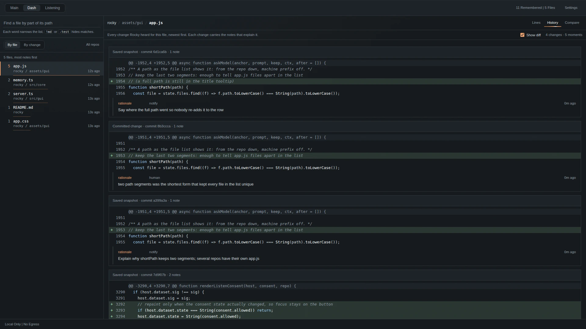
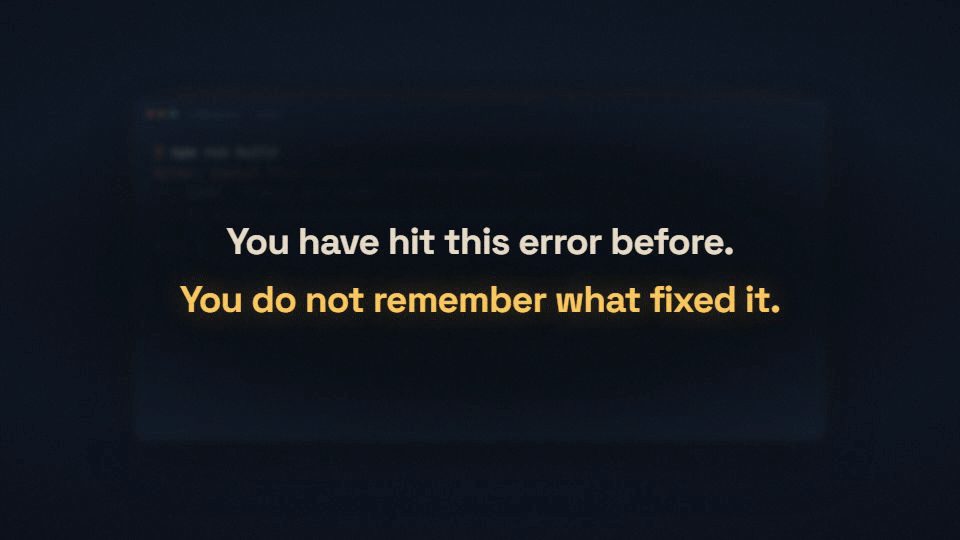
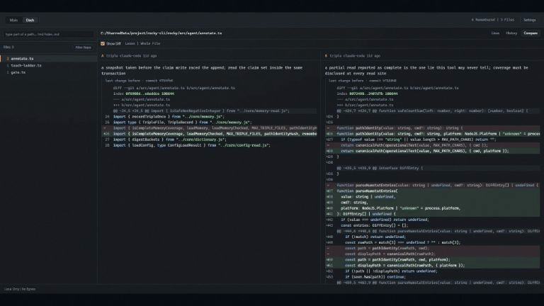
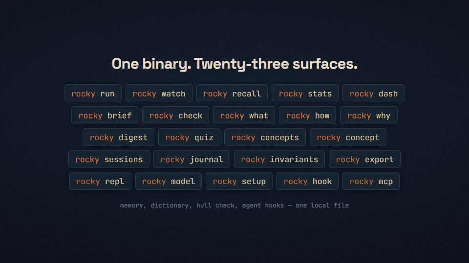

# Rocky
<p align="center"></p>
<p align="center"></p>

[](https://github.com/poggufanz/rocky/actions/workflows/ci.yml)
[](https://www.npmjs.com/package/@poggufanz/rocky-cli)
[](LICENSE)

[Release v1.1.0](https://github.com/poggufanz/rocky/releases/tag/v1.1.0) | [Changelog](CHANGELOG.md) | [License](LICENSE) | [Security](https://github.com/poggufanz/rocky/blob/main/SECURITY.md) | [Contributing](https://github.com/poggufanz/rocky/blob/main/CONTRIBUTING.md)

Your AI writes code. Rocky makes sure you still understand what you own. It is a local CLI that remembers failed commands and what fixed them, then brings that history back when the same trouble returns — to you, and through MCP to the AI agent working beside you, so it stops retrying what already failed on this machine. Supported agent hooks can also keep a bounded record of what you asked for, which files changed, and why the agent said it changed them. Rocky is a witness, not a judge: it never diagnoses a failure or proposes a fix it does not remember, and [docs/character.md](docs/character.md) holds the rules that boundary comes from.

The useful part is local and deterministic. Rocky has no daemon, no telemetry, and zero runtime dependencies. Optional AI uses an Ollama instance that you run on loopback.

> You teach, I remember. I remind, you understand. This is good trade.

## See it work

| | |
| --- | --- |
| **Failure memory** a failed build becomes a fingerprint; when the same error returns, Rocky says it has heard it before and that it went green again after — never a fix he did not hear. Evidence, not a guess. |  |
| **`rocky dash`** opens a local page in your browser: every remembered change to one file, side by side, the agent's stated reason next to the diff that landed. |  |
| **Rationale gate** an editing agent must state why before it touches a file. No stated reason, no edit; deny-once, fail-open. |  |

## Install

```bash
npm install -g @poggufanz/rocky-cli
```

Requires Node.js 18 or newer. The package name is `@poggufanz/rocky-cli`; the unrelated unscoped `rocky-cli` package is not this project.

Current release: `@poggufanz/rocky-cli@1.1.0`. See the [release notes](https://github.com/poggufanz/rocky/releases/tag/v1.1.0) or the full [changelog](CHANGELOG.md).

**Agent self-setup (any harness).** Working with an agent outside Claude Code or Codex (OpenCode, Gemini CLI, anything else)? [docs/agents/INSTALL.md](docs/agents/INSTALL.md) covers the shell hook, the notify rationale lane, and optional MCP read access, and every step that edits your files asks for approval first. On Claude Code and Codex, `rocky setup --agent-hooks` and `rocky setup` capture more, automatically. To hand it to the agent:

```text
Fetch and follow instructions from https://raw.githubusercontent.com/poggufanz/rocky/main/docs/agents/INSTALL.md
```

## Quick start

Run a failure-prone command through Rocky:

```bash
rocky run "npm run build"
```

When it fails, Rocky fingerprints the useful stderr lines and writes a local record. When the same reliable command later succeeds in the same directory, Rocky links that success to the failure. On Windows, `cmd.exe` runs the command, not Git Bash or PowerShell.

```bash
rocky recall "build failure"
```

On Bash, WSL, or PowerShell, install the shell hook if you want passive command memory:

```bash
rocky hook install
```

`rocky setup` and `rocky hook install` are separate on purpose. MCP or agent setup never edits `.bashrc` or `$PROFILE`.

`rocky what`, `rocky how`, `rocky why`, `rocky digest`, and `rocky quiz` need `rocky setup --agent-hooks` first; `rocky teach` needs a `file:line` argument or `explain` records.

On Windows, `rocky hook install` installs into every PowerShell host it finds on the machine — Windows PowerShell and PowerShell 7, both when present, each into its own `$PROFILE` — alongside the Bash hook if `.bashrc` is also in play (Git Bash/WSL). `rocky hook status` reports each host separately.

On Windows, install also says when it had to create a missing `.bashrc`, because only Git Bash reads that file there. It asks each PowerShell host for its effective execution policy too. When that policy is `Restricted` or `AllSigned`, PowerShell will not load the profile, so install and `status` say that and print `Set-ExecutionPolicy -Scope CurrentUser RemoteSigned` instead of reporting working ears; the profile is still written and the exit code stays 0. A `$PROFILE` outside your home directory is skipped unless you set `ROCKY_HOOK_ALLOW_PROFILE_OUTSIDE_HOME=1`, and the skip message names that variable.

The PowerShell hook is passive ears only: it overrides `prompt` to see a command's result right after it finishes, so it remembers failures and links fixes the same way Bash does, but — unlike the Bash hook — it cannot ask for confirmation before a dangerous command runs, because `prompt` never sees a command before it executes. Because `prompt` fires after the command's own stderr is already gone, PowerShell-hook failures are fingerprinted from the command text alone, the same command-only fallback the CLI has used since v0.4.0. One disclosed side effect: the only way PowerShell allows restoring `$?` to `False` after Rocky's own bookkeeping runs is a real, suppressed non-terminating error, which pushes one synthetic entry — named so you know it is Rocky's — onto the front of `$Error`, ahead of whatever your last real command actually raised. `$LASTEXITCODE` and `$?`'s value are always exactly what your own command left them; only `$Error[0]`'s position shifts.

### 60-second test

```bash
mkdir rocky-demo
cd rocky-demo
rocky run "node hello.js"
node -e "require('fs').writeFileSync('hello.js','console.log(1)')"
rocky run "node hello.js"
```

The first run fails and Rocky remembers it; the second run works, and Rocky knows only that the same command failed and then worked, not what changed. The link needs the same command in the same directory within eight hours, with no pipes, `&&`, globs, or `$VARS`.

## What ships

| Surface | What it does |
| --- | --- |
| Failure memory | Fingerprints errors, remembers later fixes, and searches your own history. |
| `rocky` / `rocky dash` | Open the local GUI: browse remembered failures, fixes, rationales, and diffs on loopback. |
| `rocky teach` | Explains why code exists: agent witness testimony or an assembled local evidence ladder. |
| `rocky watch` | Waits with a long-running command, saves a failed stderr tail, and notifies when work ends. |
| `rocky check` | Scans a pending push for secrets, checks new npm package names after consent, and asks one comprehension question. |
| Nervous System | Supported Claude Code and Codex hooks record bounded intent, path, excerpt, and stated-rationale evidence. |
| Dictionary | `rocky what`, `rocky how`, `rocky why`, `rocky digest`, `rocky quiz`, and `rocky export` turn remembered changes back into plain explanations. |
| `rocky mcp` | Exposes bounded memory and knowledge tools over local stdio, with sanitized output by default. |
| Rationale gate | A concept lexicon (`rocky concepts`) plus a PreToolUse gate that nudges an editing agent to state why before touching a file; deny-once, fail-open. |
| Host setup | `rocky setup` registers supported hosts after consent and can install the optional managed voice skill. |
| `rocky hook` | Manage the optional Bash, WSL, and PowerShell shell hooks. |
| `rocky model` | Configure optional loopback Ollama (`status\|use\|off`). |
| `rocky hook gate-event`, `rocky hook agent-event generic` | PreToolUse rationale-gate enforcement and the universal agent notify endpoint. |

Setup stays explicit:

```bash
rocky setup
rocky setup --harness
rocky setup --voice-skill
rocky setup --agent-hooks
rocky setup --uninstall-agent-hooks
rocky setup --status
```

For optional local ranking, install and manage Ollama yourself, then opt in:

```bash
rocky model use qwen3:0.6b-q4_K_M
rocky recall --ai "sharp build failure"
rocky model off
```

Rocky never installs or pulls a model, and it does not start or stop the shared Ollama daemon.

## Rationale evidence and the gate

Stated-rationale evidence arrives through four lanes, ranked by fidelity:

| Lane | Source | Fidelity |
| --- | --- | --- |
| `log-thinking` | Claude Code or DSH session logs, when a thinking block exists | raw |
| `log-response` | Claude Code session logs' response text, when no thinking block exists | summary |
| `notify` | Any agent calling `rocky hook agent-event <adapter> --rationale "<text>"` | summary |
| `human` | You, via `rocky why --add "<text>" [--files a.ts,b.ts]` | summary |

An unlinked file has no rationale evidence yet; that is a first-class honest state, not a gap Rocky papers over. The DSH log adapter needs Node 22.15 or newer at runtime for built-in zstd support — on an older Node it feature-detects the gap, skips DSH logs, and discloses that instead of guessing. `rocky setup --agent-hooks` installs a PreToolUse rationale gate by default (`rocky hook gate-event claude-code`): it denies once per session per file when no rationale evidence exists yet, then fails open for that file every time after. Opt out at install with `--no-rationale-gate`, or at runtime with `ROCKY_RATIONALE_GATE=off`. Codex and other non-Claude-Code agents have no deny hook at all; they reach the `notify` lane only.

## Privacy and local state

Persistent state lives under `ROCKY_HOME`; the default is `~/.rocky`. The main record is append-only JSONL at `memory.jsonl`. Depending on the features you use, that directory can also hold config, watch logs, a transient agent spool, labels, and guard rules.

Memory can contain commands, errors, working directories, prompts, bounded file excerpts, and an agent's stated rationale. Treat it as developer history: read it, back it up, or delete it on your terms.

The CLI contains no telemetry and runs no daemon. Its external network egress is narrow and named. `rocky check` asks `registry.npmjs.org` whether a newly added package name exists; that lookup is consent-gated, sends package names only, and is fail-open when offline. The GUI model picker asks `models.dev` for its model catalogue: a plain GET of `https://models.dev/api.json`, cached on disk for 24 hours, plus one logo GET whose path names the provider you configured. It sends no prompt, key, memory, or code, has no consent prompt, and fails open: an unreachable `models.dev` means an empty model list, never an error. The Main chat adds one more egress, and only when configured: a code question sends your question, carved excerpts, and memory evidence to your BYOK model, redacted and capped. Memory-only questions search all records in a complete bounded snapshot and return whole relevant records; they hold when coverage is incomplete, evidence is weak, or whole records exceed the context bound. They never call BYOK or remote Jev. Remote Jev is opt-in: only when `config.json` sets `decision.engine` to `jev` and a key is present do `rocky teach` and the GUI's teach, ask, and chat answers send the query and at most ten redacted evidence snippets to `api.typesafe.ai` (or `openrouter.ai`) for ranking. Use `memory:` to force local memory search and `code:` to force code lookup; unprefixed questions use existing code-query signals. Optional local AI connects only to `127.0.0.1`. MCP projects sanitized memory by default, and raw exposure is an explicit opt-in. A configured cloud host may forward selected projected content under that host's own policy.

Read the [security policy](https://github.com/poggufanz/rocky/blob/main/SECURITY.md) before enabling raw MCP exposure or installing hooks into a shell or agent host.

## Documentation

- [Behavior and safety reference](https://github.com/poggufanz/rocky/blob/main/docs/reference.md) covers command boundaries, memory linking, setup transactions, MCP, and platform limits.
- [Scientific grounding](https://github.com/poggufanz/rocky/blob/main/docs/scientific-grounding.md) separates product hypotheses from measured research.
- [Security policy](https://github.com/poggufanz/rocky/blob/main/SECURITY.md) explains private reporting, supported versions, sensitive state, and recovery artifacts.
- [Contributing guide](https://github.com/poggufanz/rocky/blob/main/CONTRIBUTING.md) covers the development workflow and load-bearing code.
- [Changelog](CHANGELOG.md) and [GitHub releases](https://github.com/poggufanz/rocky/releases) track shipped changes.

For questions and reproducible bugs, use [GitHub Issues](https://github.com/poggufanz/rocky/issues). Report exploitable findings through a [private security advisory](https://github.com/poggufanz/rocky/security/advisories/new).

## Development

```bash
git clone https://github.com/poggufanz/rocky.git
cd rocky
npm install
npm test
```

Repository layout: a fresh clone of the canonical upstream repository (`https://github.com/poggufanz/rocky.git`) is the package root; run `npm install`, `npm test`, and `npm pack` there. In this outer workspace, that same package root is the `rocky/` directory. Canonical developer branch is `main`; `iq` is a remediation branch, not a second release line.

Read the [contributing guide](https://github.com/poggufanz/rocky/blob/main/CONTRIBUTING.md) before changing setup, MCP, file transactions, or shell hooks. Those paths refuse uncertain state rather than guessing. The full `npm test` run is the release gate.

## License and attribution

Rocky CLI code, original project documentation, and the repository illustration are available under the [MIT License](LICENSE).

Rocky's character, voice, and illustration are original work created for this repository. No third-party logos, film assets, or other copyrighted material are distributed here.
